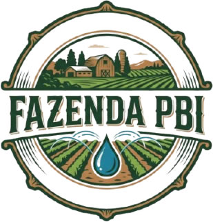
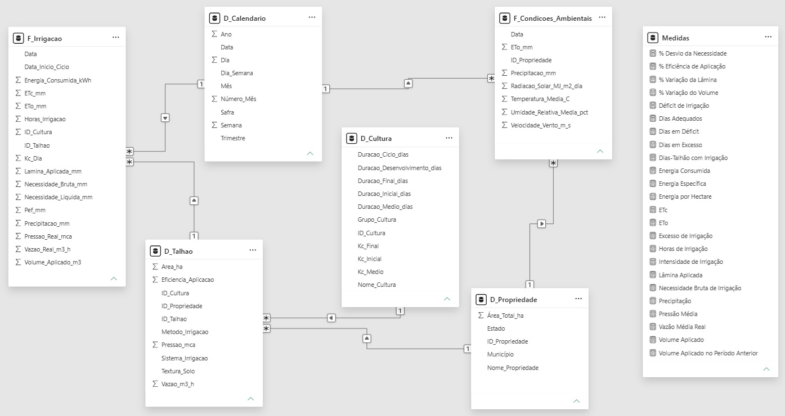

<div align="center">
  
</div>

# 🌱 Fazenda PBI — Gestão e Eficiência da Irrigação

## 🎯 Objetivo

Desenvolver um dashboard em Power BI para analisar a gestão e a eficiência da irrigação, apoiando o acompanhamento do uso da água e da energia na produção agrícola.

## 📌 Contexto do negócio

A Fazenda PBI representa uma propriedade agrícola com seis talhões e quatro culturas. O projeto utiliza dados sintéticos do período de 2020 a 2024 para analisar condições ambientais, necessidade hídrica, irrigação aplicada, eficiência e consumo energético.

## ❓ Perguntas de negócio

- Como a necessidade hídrica das culturas evolui ao longo do tempo?
- Quais talhões apresentam déficit ou excesso de irrigação?
- Como a eficiência de aplicação se compara entre os talhões?
- Quais talhões apresentam maior consumo de água e energia?
- Como as condições ambientais se relacionam com a necessidade de irrigação?
- Onde existem oportunidades de melhoria na gestão hídrica e energética?

## 📊 Dashboard

### Visão Geral da Irrigação

Visão consolidada dos principais indicadores, do volume aplicado, da precipitação, da necessidade bruta e da situação da irrigação por talhão.


### Análise Hídrica

Análise da ETc, da necessidade bruta e da lâmina aplicada, com acompanhamento mensal do déficit e do excesso de irrigação.


### Eficiência dos Talhões

Comparação da eficiência de aplicação, do déficit e do excesso de irrigação entre os seis talhões.


### Operação e Energia

Monitoramento das horas de irrigação, vazão, pressão e consumo energético, incluindo indicadores por talhão e por hectare.


## 📈 Principais KPIs

| KPI | Finalidade |
|---|---|
| Volume e lâmina aplicada | Acompanhar a irrigação realizada |
| ETc e necessidade bruta | Avaliar a demanda hídrica |
| Eficiência de aplicação | Comparar o desempenho dos sistemas |
| Déficit e excesso de irrigação | Identificar desvios na aplicação |
| Horas de irrigação e vazão média | Acompanhar a operação |
| Energia consumida | Monitorar o consumo energético |
| Energia específica e por hectare | Comparar indicadores de consumo |

## 🗂️ Modelo de dados

Modelo composto por seis tabelas, organizadas em quatro dimensões e duas tabelas fato.



**Dimensões**
- `D_Calendario`
- `D_Propriedade`
- `D_Talhao`
- `D_Cultura`

**Tabelas fato**
- `F_Condicoes_Ambientais`
- `F_Irrigacao`

## 🧮 Exemplos de DAX

As medidas DAX calculam os indicadores hídricos, operacionais e energéticos e permitem analisar sua evolução conforme os filtros do relatório.

### Volume Aplicado

```dax
Volume Aplicado =
SUM(F_Irrigacao[Volume_Aplicado_m3])
```

### Precipitação

```dax
Precipitação =
SUM(F_Condicoes_Ambientais[Precipitacao_mm])
```

### Dias-talhão com irrigação

```dax
Dias-Talhão com Irrigação =
COUNTROWS(
    FILTER(
        F_Irrigacao,
        F_Irrigacao[Horas_Irrigacao] > 0
    )
)
```

## 🛠️ Tecnologias e técnicas

- **Microsoft Power BI** — modelagem e visualização dos dados;
- **Power Query** — transformação e preparação dos dados;
- **DAX** — medidas e indicadores;
- **CSV** — armazenamento dos dados utilizados no projeto.

## ✅ Resultados

O projeto apresenta uma solução de Business Intelligence aplicada ao contexto agrícola, reunindo indicadores hídricos e operacionais em quatro páginas interativas para apoiar a análise da irrigação e do consumo de energia.

Os dados são sintéticos e têm finalidade demonstrativa.

---

> **Projeto fictício:** a Oracle AgroWater e todos os dados apresentados neste projeto são simulados e foram desenvolvidos exclusivamente para fins de estudo e demonstração de conhecimentos em Business Intelligence.
